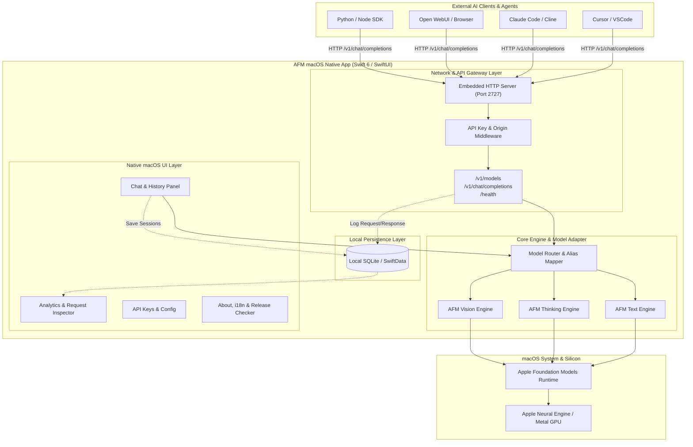

# Product Requirements Document (PRD)
## AFM — Apple Foundation Model Bridge & Native Client for macOS

---

| **Document Version** | 1.1.0 |
| **Status** | Approved for Development |
| **Target OS** | macOS 26 / 27 (Apple Silicon M-Series) |
| **Default Port** | `2727` (macOS 27 Signature Port, bebas konflik dengan 5432 Postgres) |
| **Author / Lead** | ardith666 (https://github.com/ardith666) |
| **Tech Stack** | Swift 6, SwiftUI, Swift-NIO / Hummingbird (HTTP Engine), Local SQLite / SwiftData |
| **License & Repo** | Private Core Repo (`afm-core`) + Public Release (`afm`) / Brew Tap (`homebrew-afm`) |

---

## 1. Executive Summary & Vision

### 1.1 Problem Statement
Apple Intelligence dan Apple Foundation Models (AFM) menyediakan model bahasa lokal yang cepat, hemat daya, dan terintegrasi langsung dengan Apple Silicon Neural Engine (NPU/ANE). Namun, model-model ini terkunci dalam ekosistem Apple API internal dan tidak dapat digunakan langsung oleh tool AI populer para developer (seperti Cursor, Claude Code, Cline, Open WebUI, Continue.dev, Ollama-compatible clients, LangChain, dll.) yang mayoritas mengandalkan protokol HTTP REST API standar OpenAI (`/v1/chat/completions`).

### 1.2 Solution
**AFM** adalah aplikasi desktop native macOS bergaya modern (macOS 27 Liquid Design) yang berfungsi sebagai **Local Inference Bridge Server + Native Management Studio**:
1. Menjalankan local server HTTP REST API standar OpenAI (`http://127.0.0.1:2727/v1`) dengan otentikasi API Key. Port default `2727` dipilih khusus untuk merepresentasikan macOS 27 dan sepenuhnya bebas dari konflik port populer (seperti PostgreSQL 5432, MySQL 3306, Ollama 11434).
2. Mengekspos model on-device bawaan macOS dengan dukungan:
   - **Text Generation Model**: Text-to-text cepat dan hemat memori.
   - **Thinking / Reasoning Model**: Mendukung chain-of-thought dengan streaming reasoning tokens (`<thought>` / `reasoning_content`).
   - **Vision / Multimodal Model**: Menerima input gambar (base64 / URL lokal) untuk analisis visual.
3. Mengusung arsitektur **100% Local-First & Zero Telemetry** demi privasi total.
4. Menyediakan **Native Chat Studio** interaktif dengan riwayat obrolan.
5. Menyediakan **Observability Dashboard** lengkap (monitoring latency TTFT, request/response payload, throughput TPS, dan token usage).
6. Mendukung internasionalisasi (**English (Default)** dan **Bahasa Indonesia**), auto update via **GitHub Releases**, serta instalasi mudah lewat **Homebrew Tap (`brew tap`)**.

---

## 2. Target Persona & Use Cases

- **AI Engineer & Developer**: Ingin menghemat biaya token API cloud untuk coding agent (Cursor, Cline, Claude Code) dengan memanfaatkan NPU Mac secara gratis dan offline.
- **Privacy-Conscious Professional**: Menjalankan analisis dokumen rahasia, audit kode internal, dan ekstraksi data gambar tanpa ada data yang keluar dari laptop.
- **Local AI Enthusiast**: Menggunakan satu aplikasi elegan tanpa perlu setup Python environment, Ollama CLI manual, atau Docker container yang boros RAM.

---

## 3. Product Architecture



---

## 4. Detailed Feature Specifications

### 4.1 OpenAI-Compatible HTTP Server & API Engine
* **Protocol**: HTTP/1.1 & HTTP/2 over loopback (`127.0.0.1` atau `0.0.0.0` opsional jika diizinkan di Settings).
* **Default Port**: `2727` (Signature macOS 27 port; aman dari konflik database/services seperti Postgres 5432 atau Redis 6379. Dapat diubah via UI Settings).
* **Authentication**: Bearer Token Authorization (`Authorization: Bearer afm-<hash>`).
* **Supported Endpoints**:
  1. `GET /v1/models`: Mengembalikan daftar model yang aktif beserta kapabilitasnya.
  2. `POST /v1/chat/completions`:
     - Standard request payload: `model`, `messages`, `stream`, `temperature`, `max_tokens`, `stop`.
     - **Streaming Support**: Server-Sent Events (`text/event-stream`) dengan format `data: {"choices": [{"delta": {"content": "..."}}]}` diakhiri `data: [DONE]`.
     - **JSON Mode**: Mendukung parameter `response_format: { "type": "json_object" }`.
  3. `GET /health` & `GET /v1/health`: Liveness & readiness check.

#### Model Registry & Aliasing:
| Model ID Bawaan | Tipe | Deskripsi & Format Khusus |
|---|---|---|
| `afm-text` | Text | Model instruksi standar, latensi sangat rendah. |
| `afm-thinking` | Reasoning | Mendukung Chain-of-Thought. Pada format streaming mengeluarkan field `reasoning_content` atau tag `<thought>...</thought>`. |
| `afm-vision` | Multimodal | Menerima array `content: [{"type": "text"}, {"type": "image_url", "image_url": {"url": "data:image/png;base64,..."}}]`. |

* **Custom Model Aliasing**: Pengguna dapat mendefinisikan alias seperti `gpt-4o`, `claude-3-5-sonnet`, atau `o3-mini` yang dipetakan ke model AFM internal, sehingga agent pihak ketiga dapat langsung terhubung tanpa perlu mengganti nama model pada konfigurasi agent mereka.

---

### 4.2 Native macOS UI Panels (macOS 27 Design System)

Mengadopsi pedoman desain modern macOS (Vibrant Acrylic Glass, SF Symbols 6, Native NavigationSplitView, Menu Bar integration, Dark & Light Mode otomatis).

#### Panel 1: Chat Studio & History
* **Sidebar Sesi**:
  * Daftar obrolan tersimpan dikelompokkan berdasarkan tanggal (*Today, Yesterday, Previous 7 Days*).
  * Tombol *New Chat* (`Cmd + N`), tombol pin obrolan penting, dan pencarian riwayat obrolan (*Full-Text Search* lokal).
  * Ekspor percakapan ke format Markdown atau JSON.
* **Main Chat View**:
  * Dropdown pemilihan model (`afm-text`, `afm-thinking`, `afm-vision`).
  * Rendering Markdown responsif dengan code block syntax highlighting, tombol *Copy Code*, dan LaTeX rendering.
  * **Thinking Box Component**: Obrolan reasoning model menampilkan kartu collapsible *"Thinking Process (x seconds)"* yang dapat diperluas untuk melihat alur logika internal sebelum jawaban final.
  * **Vision Input**: Area input mendukung *Drag & Drop* gambar, paste gambar dari clipboard (`Cmd + V`), dan preview thumbnail dengan tombol hapus sebelum dikirim.
  * **Streaming Visualizer**: Animasi kursor tikar halus saat token di-stream secara real-time.

#### Panel 2: Observability Dashboard & Analytics
* **Live Activity Feed**:
  * Tabel real-time riwayat request dari client luar (Cursor, Claude Code, dll) maupun chat lokal.
  * Kolom: Timestamp, Client IP/Agent, Model, HTTP Status (200, 401, 500), TTFT (Time-to-First-Token in ms), Total Latency, Token In/Out, TPS (Tokens Per Second).
* **Detailed Request Inspector (Drawer / Popover)**:
  * Mengklik sebuah request akan membuka detail lengkap:
    * Headers HTTP
    * Request JSON Body (Payload Prompt / Messages)
    * Rendered Images (jika Vision request)
    * Raw Response Stream / Complete Completion JSON
* **Metrics & Analytics Charts**:
  * **Throughput Meter**: Gauge real-time kecepatan token (Tokens/Sec).
  * **Request Volume Chart**: Grafik batang interaktif jumlah request per jam/hari.
  * **Token Consumption**: Total token prompt & completion yang telah dihemat vs estimasi biaya cloud API.
  * **Model Distribution**: Diagram pie perbandingan penggunaan Text vs Thinking vs Vision.
* **Control Actions**:
  * Filter berdasarkan status / rentang tanggal / model.
  * Tombol *Clear History* dan *Export Audit Logs (JSON/CSV)*.

#### Panel 3: Settings & API Management
* **Service Lifecycle Controls**:
  * Indikator status live (`HTTP Service Active: http://127.0.0.1:2727` vs `HTTP Service Stopped`).
  * Tombol interaktif:
    * **▶ Start Service**: Memulai listener server jika sedang berhenti.
    * **⏹ Stop Service**: Menghentikan server agar tidak menerima koneksi luar.
    * **⟳ Restart Service**: Melakukan restart listener server secara instan.
  * Selector port custom (default: `2727`) dengan tombol *Apply*.
* **System & Startup Preferences**:
  * **Start at Login**: Toggle aktivasi peluncuran otomatis saat login ke macOS via modern `SMAppService` API.
  * **Automatic Updates**:
    * Toggle pemeriksaan rilis otomatis harian via GitHub Releases API.
    * Selector channel rilis: *Stable Releases (Recommended)* dan *Pre-release / Beta*.
    * Tombol *Check Now* untuk pengecekan versi instan.
* **API Key Manager**:
  * Pembuatan multiple API keys dengan label (misal: "Cursor Mac", "Claude Code CLI", "Test Key").
  * Masked display (`afm-xxxx...xxxx`) dengan tombol One-Click Copy dan Rotate Key.
  * Kemampuan menonaktifkan (*revoke*) atau menghapus key kapan saja.
* **Model Aliasing Configurator**:
  * Tabel mapping alias (e.g., input: `gpt-4o` -> target: `afm-vision`, `claude-3-5-sonnet` -> target: `afm-thinking`).

#### Panel 4: About, Developer Profile, Changelog & Release Updates
* **Language Switcher**:
  * Opsi bahasa: **English (Default)** dan **Bahasa Indonesia**.
  * Switcher instan tanpa perlu restart aplikasi (reaktif via SwiftUI `@Environment(\.locale)`).
* **Developer Profile & Credits**:
  * Ditampilkan secara elegan: Profil GitHub [@ardith666](https://github.com/ardith666) dengan avatar, bio, dan link portofolio (https://digitechnesia.my.id/portofolio).
  * Tombol interaktif *"View GitHub Profile"* dan *"Sponsor / Star on GitHub"*.
* **In-App Changelog Viewer**:
  * Tab atau modal khusus untuk melihat riwayat rilis (*Release Notes*) per versi:
    * Tag versi, tanggal rilis, dan badge status (*Current*, *Newer*).
    * Kategori perubahan: `Added`, `Changed`, `Fixed`, `Security`.
    * Sumber data: Dibundel secara lokal (offline fallback) dan diperbarui dinamis dari GitHub Releases.
* **Application Meta**:
  * Logo AFM bergaya icon macOS 27 dengan efek liquid shadow.
  * Versi aplikasi, build number, status arsitektur (*Apple Silicon M-Series Native*).
  * Indikator status model bawaan macOS (*Ready / Warming Up / Unavailable*).
* **GitHub Release Checker**:
  * Terkoneksi ke GitHub Releases API (`repos/ardith666/afm/releases/latest`).
  * Tombol *Check for Updates*.
  * Jika ada update baru: Menampilkan modal berisi Version Tag, Release Notes (Changelog Markdown), dan tombol *Download DMG* atau petunjuk *Upgrade via Brew* (`brew upgrade afm`).

---

## 5. Security, Privacy & Local-First Guarantees

1. **Zero External Network Exfiltration**:
   - Seluruh inferensi dieksekusi 100% pada hardware lokal via Apple Neural Engine & Metal.
   - Tidak ada analitik telemetri pihak ketiga (Google Analytics, Mixpanel, dll) yang disematkan.
   - Satu-satunya koneksi internet keluar adalah pemeriksaan versi ke GitHub API (hanya jika pengguna mengklik atau mengaktifkan *Check for Updates*).
2. **Local Data Persistence**:
   - Riwayat chat dan log transaksi disimpan dalam database lokal SQLite (`~/Library/Application Support/AFM/afm_store.sqlite`) terenkripsi dengan Apple FileSystem Sandbox.
3. **Loopback Default Binding**:
   - Server secara default hanya mendengar pada `127.0.0.1`, mencegah perangkat lain di jaringan Wi-Fi publik mengakses model tanpa izin.

---

## 6. Repository Strategy & Distribution (Brew Tap)

### 6.1 Dual-Repository Structure

```
┌────────────────────────────────────────────────────────┐
│ GitHub Private Repo: github.com/ardith666/afm-core     │
│ - Source code lengkap (SwiftUI, HTTP Engine, Adapters) │
│ - Unit & Integration Tests                             │
│ - Internal CI/CD Scripts                               │
└──────────────────────────┬─────────────────────────────┘
                           │ GitHub Action (Build & Sign)
                           ▼
┌────────────────────────────────────────────────────────┐
│ GitHub Public Distribution: github.com/ardith666/afm   │
│ - GitHub Releases (Assets: AFM-{version}.dmg, .tar.gz) │
│ - Release Notes & Documentation                        │
│ - Issue Tracker publik & Feedback                      │
└──────────────────────────┬─────────────────────────────┘
                           │ Auto-trigger PR / Push
                           ▼
┌────────────────────────────────────────────────────────┐
│ Homebrew Tap Repo: github.com/ardith666/homebrew-afm   │
│ - Cask Formula: Casks/afm.rb                           │
│ - CLI Formula: Formula/afm-cli.rb                      │
└────────────────────────────────────────────────────────┘
```

### 6.2 Homebrew Installation Flow
Pengguna dapat menginstal AFM semudah satu baris perintah:
```bash
# Tambahkan tap repository
brew tap ardith666/afm

# Install aplikasi desktop (macOS Cask)
brew install --cask afm

# (Opsional) Jalankan via CLI daemon
brew install afm
afm start
```

### 6.3 Formula Cask Definition (`afm.rb`):
```ruby
cask "afm" do
  version "1.0.0"
  sha256 "AUTOMATED_SHA256_HASH_FROM_RELEASE"

  url "https://github.com/ardith666/afm/releases/download/v#{version}/AFM-#{version}-arm64.dmg"
  name "AFM"
  desc "Local Apple Foundation Model bridge to OpenAI-compatible HTTP API"
  homepage "https://github.com/ardith666/afm"

  depends_on arch: :arm64
  depends_on macos: ">= :sonoma"

  app "AFM.app"

  zap trash: [
    "~/Library/Application Support/AFM",
    "~/Library/Caches/com.ardith666.afm",
    "~/Library/Preferences/com.ardith666.afm.plist",
  ]
end
```

---

## 7. Integration Guide with Popular Agents

### 7.1 Cursor / Windsurf
* **Base URL**: `http://127.0.0.1:2727/v1`
* **API Key**: `afm-xxxxxxxxxxxx`
* **Model**: `afm-text` atau `afm-thinking`

### 7.2 Claude Code / Cline / Roo-Code
* Di setting provider pilih `OpenAI-Compatible`:
  * Base URL: `http://127.0.0.1:2727/v1`
  * API Key: Masukkan key dari AFM
  * Model ID: `afm-text` (atau gunakan alias `gpt-4o` jika agent memvalidasi format nama model).

### 7.3 Python / OpenAI Official SDK
```python
from openai import OpenAI

client = OpenAI(
    base_url="http://127.0.0.1:2727/v1",
    api_key="afm-custom-key"
)

# Text / Thinking Completion
response = client.chat.completions.create(
    model="afm-thinking",
    messages=[{"role": "user", "content": "Rancang algoritma scheduling efisien"}],
    stream=True
)

for chunk in response:
    if chunk.choices[0].delta.content:
        print(chunk.choices[0].delta.content, end="", flush=True)
```

---

## 8. App Icon & Animated Drag-and-Drop DMG Installer

### 8.1 macOS 27 App Icon Specifications
* **Design Aesthetic**:
  - Mengikuti standar Apple Human Interface Guidelines untuk macOS squircle (1024x1024 master).
  - Material Liquid Glass bertekstur frosted acrylic dengan refleksi cahaya diagonal.
  - Pusat icon menampilkan *Neural Hologram Core* dengan aksen gradasi Apple Intelligence (violet, deep indigo, neon cyan, warm amber).
  - Huruf atau simbol "AFM" dengan tipografi SF Pro Display Rounded yang berwibawa dan modern.
* **Output Format**:
  - `AppIcon.icns` lengkap dengan seluruh resolusi (16x16, 32x32, 64x64, 128x128, 256x256, 512x512, 1024x1024 @1x/@2x).

### 8.2 Animated Drag-and-Drop DMG Installer Canvas
* **Window Specifications**:
  - Ukuran window DMG: `660 x 420 px`.
  - Background Canvas: Tema Neo-Brutalism + macOS 27 Glassmorphism dengan kontur halus.
  - Ilustrasi Visual Drag:
    - Kiri (`x: 170, y: 220`): Ikon aplikasi `AFM.app`.
    - Tengah (`x: 330, y: 220`): Animasi visual panah dinamis melengkung dengan partikel neon dan tulisan *"Drag to Applications"*.
    - Kanan (`x: 490, y: 220`): Symlink folder `/Applications`.
  - Skrip otomasi pembuatan via `hdiutil` dan AppleScript `.DS_Store` builder (`scripts/build_dmg.sh`).

---

## 8. Development Milestones & Roadmap

| Phase | Duration | Core Deliverables |
|---|---|---|
| **Phase 1: Foundation & Server Engine** | Week 1–2 | • Setup Swift Package & Embedded HTTP Server.<br>• Implementasi endpoint `/v1/models` & `/v1/chat/completions` (JSON & SSE Streaming).<br>• Integrasi adapter model bawaan macOS (Text, Thinking, Vision). |
| **Phase 2: macOS UI Studio** | Week 3–4 | • Desain antarmuka SwiftUI bergaya macOS 27.<br>• Panel Chat dengan Markdown & Thinking Box.<br>• Input multimodal vision (drag & drop image).<br>• Manajemen API Key & Port config. |
| **Phase 3: Observability Dashboard & i18n** | Week 5 | • Dashboard analitik latensi, TTFT, token counter, request inspector.<br>• Lokalisasi bahasa: English (Default) & Bahasa Indonesia.<br>• Halaman About dengan GitHub Release checker. |
| **Phase 4: Packaging, Brew Tap & Distribution** | Week 6 | • Setup GitHub Actions CI/CD (Notarized DMG builder).<br>• Setup repository publik release & repository `homebrew-afm`.<br>• E2E Integration testing dengan Cursor, Cline, dan Python SDK. |

---
*Dokumen ini dirancang sebagai acuan arsitektur dan spesifikasi implementasi resmi proyek AFM.*
