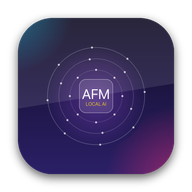

# AFM — Apple Foundation Model Bridge for macOS

<p align="center">
  
</p>

<p align="center">
  <b>Turn Built-in macOS 27 LLMs into an OpenAI-Compatible HTTP Server</b><br>
  100% On-Device • Apple Silicon Neural Engine • Port 2727 • Zero Cost
</p>

<p align="center">
  <a href="#installation"></a>
  <a href="https://github.com/ardith666/afm/releases"></a>
  <a href="https://github.com/ardith666/afm/blob/main/LICENSE"></a>
</p>

---

## ⚡ Quick Start

### Install via Homebrew Cask

```bash
brew tap ardith666/afm
brew install --cask afm
```

### Direct Download
Download the latest notarized **`AFM-1.0.0-arm64.dmg`** with animated drag installer from [GitHub Releases](https://github.com/ardith666/afm/releases/latest).

---

## 🚀 Key Features

- **Standard OpenAI Compatibility**: Connect effortlessly to Cursor, Claude Code, Cline, Open WebUI, and Python SDK at `http://127.0.0.1:2727/v1`.
- **Three Supported Models**:
  - `afm-text`: Ultra-low latency general instruction model.
  - `afm-thinking`: Reasoning model with chain-of-thought streaming (`reasoning_content` / `<thought>`).
  - `afm-vision`: Multimodal vision model accepting image URLs / base64 payloads.
- **macOS 27 Native Design**: SwiftUI with frosted glass acrylics, dark/light mode, and status bar presence.
- **In-App Studio & Observability Dashboard**: Built-in chat playground, real-time request logs, TTFT, and tokens/sec telemetry.
- **i18n Localization**: English (default) & Bahasa Indonesia.

---

## 👨‍💻 Author

Crafted by **[ardith666](https://github.com/ardith666)**
- Portfolio: [https://digitechnesia.my.id/portofolio](https://digitechnesia.my.id/portofolio)
